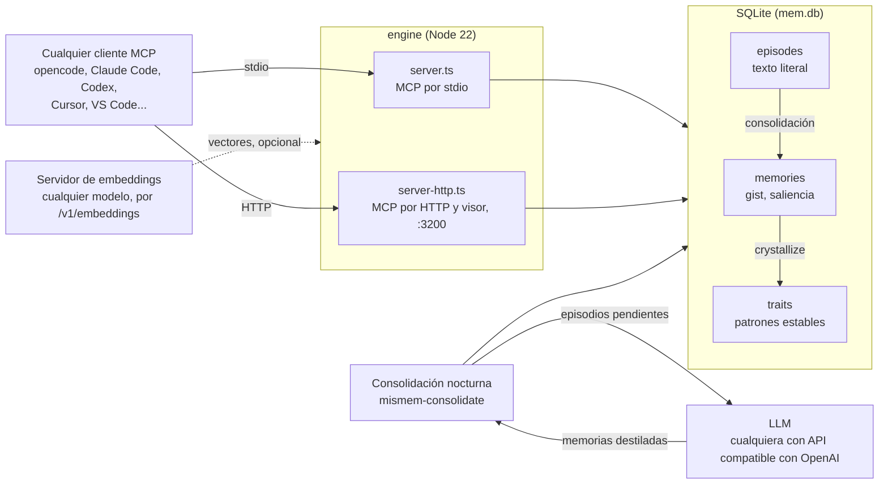

<p align="center">
  <picture>
    <source media="(prefers-color-scheme: dark)" srcset="docs/assets/logo-dark.webp">
    
  </picture>
</p>

<h1 align="center">misMEM</h1>

<p align="center">
  <strong>Memoria persistente cooperativa para LLMs.</strong><br>
  Una SQLite, un protocolo MCP, todos tus clientes.
</p>

<p align="center">
  <a href="https://github.com/lucasmella-stack/misMEM/actions/workflows/ci.yml"></a>
  <a href="https://github.com/lucasmella-stack/misMEM/releases/latest"></a>
  <a href="LICENSE"></a>
  <a href="engine/package.json"></a>
</p>

## Qué es y por qué

Cada instancia de un LLM nace sin memoria, y cada herramienta (opencode, Claude Code, Codex, Cursor,
VS Code...) guarda lo suyo en silos incompatibles: hay que repetir el contexto y la continuidad muere entre
sesiones. misMEM lo resuelve con **una base SQLite (`~/.mismem/mem.db`) y un protocolo MCP de seis
invocaciones**, accesible desde cualquier cliente que hable MCP. *La cooperatividad hace a la persistencia
de la información.*

La memoria tiene tres capas, como la biológica, y la pérdida es intencional: lo crudo se disuelve, lo
destilado persiste, lo cristalizado permanece.



## Quickstart

### Linux: un script lo configura todo

```bash
git clone https://github.com/lucasmella-stack/misMEM.git && bash misMEM/scripts/install.sh
```

Pregunta dónde guardar la memoria y con qué proveedor consolidar (DeepSeek, OpenRouter, OpenAI, un
servidor compatible o ninguno), deja la clave en `~/.config/mismem/env` con permisos 600 y configura
los clientes MCP que encuentre, con los hooks de inyección y refuerzo en Claude Code. Ofrece además
montar un servidor de embeddings local para la búsqueda por significado
([otro servidor u otro modelo](docs/recall.md#por-significado-opcional)) y dejar la consolidación
nocturna como timer de systemd.

Los clientes llaman a `~/.local/bin/mismem-run`, así que ninguna clave queda en su configuración.
Volver a ejecutarlo actualiza sin duplicar y respeta lo que esté configurado a mano. `--help` explica
el resto: `--from-npm`, el modo sin preguntas y qué clientes toca.

### Docker: un servidor para varias máquinas

```bash
docker run -d --name mismem-brain \
  -e MISMEM_AUTH_USER=brain -e MISMEM_AUTH_PASS=<contraseña> \
  -v mismem-data:/data -p 127.0.0.1:3200:3200 \
  ghcr.io/lucasmella-stack/mismem-brain:latest
curl http://127.0.0.1:3200/healthz
```

Imagen multi-arch (`linux/amd64` y `linux/arm64`). El visor queda en `/viewer` y el MCP en `/mcp`;
para exponerlo con Traefik y TLS, [DEPLOY.md](DEPLOY.md).

### npm: sin clonar nada

En la configuración MCP del cliente; el fichero y la forma cambian de uno a otro. Éste es el de los que
usan `mcpServers` en JSON:

```json
{
  "mcpServers": {
    "mismem": {
      "command": "npx",
      "args": ["-y", "@lucasmella/mismem"]
    }
  }
}
```

La base se crea sola en el primer uso (`~/.mismem/mem.db`, configurable con `MISMEM_DB`) y no sale de la
máquina; las dos funciones opcionales que mandan texto afuera están en [Privacidad](#privacidad).

<details>
<summary>Desde el código</summary>

```bash
git clone https://github.com/lucasmella-stack/misMEM.git
cd misMEM/engine
pnpm install
pnpm test        # todo verde antes de usar
pnpm build       # compila a dist/
```

Y en la configuración MCP del cliente: `"command": "node", "args": ["<ruta-al-repo>/misMEM/engine/dist/server.js"]`.

</details>

## Qué incluye

| | Qué hace | Más |
|---|---|---|
| **Seis invocaciones** | `capture`, `recall`, `reinforce`, `consolidate`, `crystallize`, `forget`, más una capa de compatibilidad con Engram (`mem_save`, `mem_search`, ...) | [Arquitectura](docs/architecture.md#seis-invocaciones) |
| **Recall híbrido** | Palabras (FTS5) y significado (embeddings, opcional) fusionados por RRF sobre las tres capas a la vez. Si el servidor de embeddings cae, sigue por palabras | [Recall](docs/recall.md) |
| **Medido, no supuesto** | Un corpus dorado público en castellano y `pnpm eval`: aciertos y MRR por tipo de pregunta, contra un suelo declarado | [Recall](docs/recall.md) |
| **Saliencia con decay** | Lo que no se usa pierde la mitad cada 90 días; el refuerzo sigue el uso real, no la aparición | [Arquitectura](docs/architecture.md#saliencia-decay-y-olvido) |
| **Índice hebbiano** | Cuenta qué recuerdos se usaron juntos en el mismo turno | [Arquitectura](docs/architecture.md#el-índice-hebbiano) |
| **Ámbitos** | Un `scope` por proyecto o cliente dentro de la misma base; una búsqueda con ámbito no mezcla los demás | [Arquitectura](docs/architecture.md#un-territorio-varias-instancias) |
| **Consolidación nocturna** | Un LLM destila los episodios en memorias, con prefiltro de ruido | [Consolidación](engine/src/consolidation/README.md) |
| **Visor web** | Memorias, rasgos, lo pendiente, el origen de cada recuerdo, el estado del índice semántico y el grafo; con acciones opcionales | [Arquitectura](docs/architecture.md#componentes) |
| **Temas** | Qué recuerdos hablan de lo mismo aunque vivan en ámbitos distintos, calculado sobre los vectores. El grafo se puede pintar por tema | [Arquitectura](docs/architecture.md#componentes) |
| **Lo que el modelo recibe** | El servidor anuncia cuándo usar cada herramienta; cada resultado de `recall` trae su capa, su fecha, los detalles y la polaridad | [Arquitectura](docs/architecture.md#seis-invocaciones) |
| **Hooks de cliente** | Adelantan recuerdos antes de responder y refuerzan los que se usaron | [Hooks](docs/hooks.md) |
| **Ingesta y exportación** | Exports de ChatGPT, transcripts de VS Code, migración desde Engram, bóveda de Obsidian | [Arquitectura](docs/architecture.md#componentes) |
| **Servidor remoto** | MCP por Streamable HTTP con BasicAuth, guarda de `Host` y límite de cuerpo; el visor entra por su propio formulario | [DEPLOY.md](DEPLOY.md) |

## El visor

Capturas del visor (`/viewer`): el grafo entero con sus ajustes, y el grafo local alrededor de una
memoria con su detalle al costado. Cada nodo mide sus conexiones visibles y se pinta por ámbito o por
tema.

<p align="center">
  
  
</p>

## Documentación

| Para | Ir a |
|---|---|
| Operar un servidor, y todas las variables de entorno | [DEPLOY.md](DEPLOY.md) |
| Entender el motor | [docs/architecture.md](docs/architecture.md), [docs/recall.md](docs/recall.md), [docs/hooks.md](docs/hooks.md) |
| Contribuir | [CONTRIBUTING.md](CONTRIBUTING.md) y las [normas](docs/standards/README.md) |
| Convenciones para agentes | [AGENTS.md](AGENTS.md) |
| Qué cambió en cada versión | [CHANGELOG.md](CHANGELOG.md) |
| Reportar una vulnerabilidad | [SECURITY.md](SECURITY.md) |
| Qué documento es para quién | [docs/README.md](docs/README.md) |

## Privacidad

La memoria es de quien la usa. La base (`*.db`), los volcados y los exports personales están en
`.gitignore`: **nunca** se commitean. El servidor HTTP sin `MISMEM_AUTH_USER` y `MISMEM_AUTH_PASS` corre
sin autenticación: así sólo en localhost.

Dos funciones opcionales mandan texto fuera del proceso, y sólo si se configuran:

- **Búsqueda por significado**: el servidor de embeddings recibe el texto de cada memoria, de cada rasgo,
  de cada episodio pendiente y de cada consulta. Conviene correrlo en la propia máquina o en la red interna.
- **Consolidación con LLM**: los episodios viajan textuales al proveedor configurado (DeepSeek,
  OpenRouter, OpenAI o cualquier servidor compatible). Sin su clave no corre, y apuntándola a un servidor
  de la propia red no sale nada.

## Contribuir

Los issues y los PR son bienvenidos. El punto de partida es [CONTRIBUTING.md](CONTRIBUTING.md): entorno,
flujo, formularios de issue y plantillas de PR.

## Gracias

misMEM lo arrancó una persona sola, pero no siguió así.
[**@iDiagoValeta**](https://github.com/iDiagoValeta) colaboró en su desarrollo de forma activa como muestra
de su amor y apoyo incondicional hacia el Open-Source.

## Licencia

MIT. Ver [LICENSE](LICENSE).
